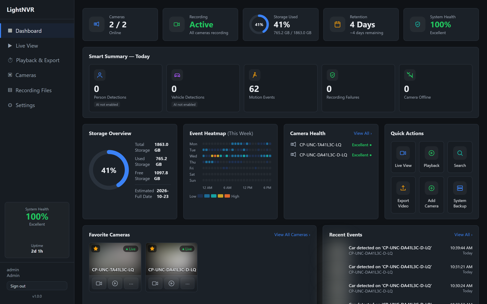
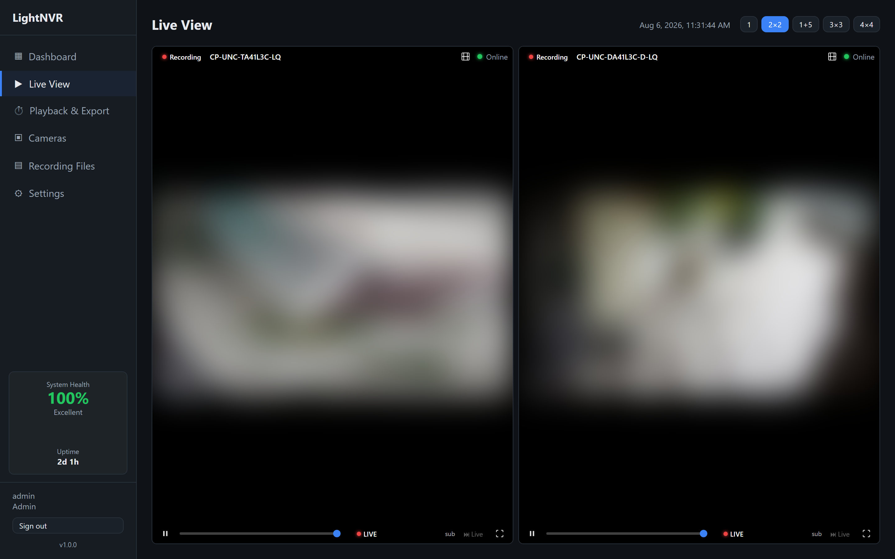
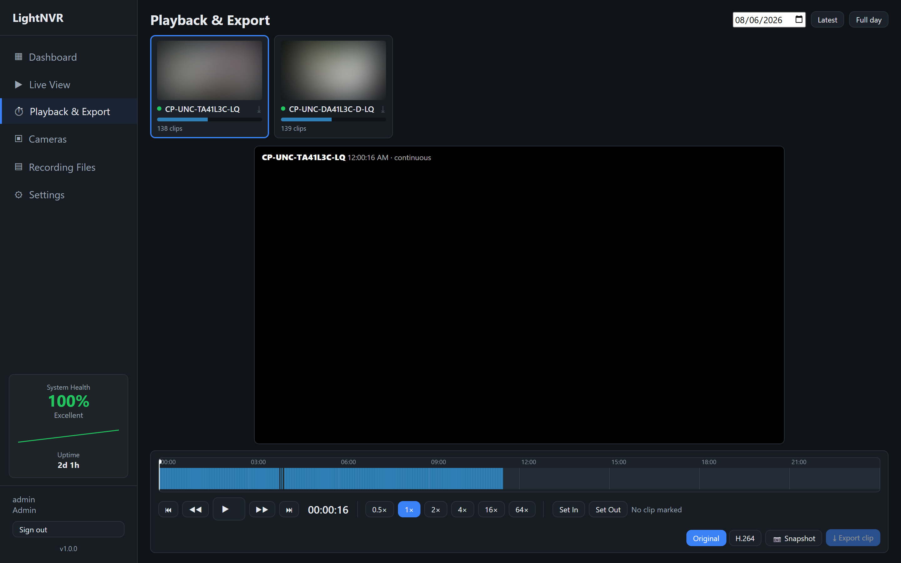

<div align="center">

# 🎥 LightNVR

### The self-hosted NVR that's actually easy.

**Point-and-click camera setup. No YAML. Runs on a Raspberry Pi. Free forever.**

[](LICENSE)
[](https://github.com/manojmkss/Light_NVR/releases)
[-2496ED?logo=docker&logoColor=white)](https://github.com/manojmkss?tab=packages)



</div>

---

LightNVR is an open-source network video recorder for your own IP cameras — record, watch live, scrub back through footage, and get smart motion alerts, all on hardware you own with **nothing in the cloud**. It aims to give you the power of the big NVR apps **without the config files, the paywalls, or the vendor lock-in**.

```bash
docker compose pull && docker compose up -d
# open https://<host>:8443 — the browser wizard does the rest
```

## Why LightNVR?

- 🖱️ **Set up entirely in the browser.** A first-run wizard creates your admin account, picks storage, and scans for cameras. No editing YAML, no config files.
- 📦 **One command to run.** Prebuilt Docker images for **amd64 and arm64** — the same setup works on a home server, a mini-PC, or a Raspberry Pi.
- 🧠 **Smart alerts, not noise.** Optional AI (YOLO) means an alert fires when there's *actually a person or car* — not every swaying tree or passing shadow.
- 🎞️ **Plays everywhere.** Records efficient H.265 but plays back instantly in any browser (Firefox/Chrome included) — no "unsupported codec" black screens.
- 🔒 **Truly free & open.** AGPLv3 — it can't be taken closed-source or turned into a paywalled product. Your footage never leaves your network.
- 🛡️ **Set-and-forget resilience.** Survives reboots, flaky NAS connections, and even a camera's IP changing after a router reboot (self-healing re-discovery).

## Features

| | |
|---|---|
| **📹 Cameras** | ONVIF auto-discovery, multi-channel NVR import, auto main/sub stream detection, H.264 & H.265, per-camera settings |
| **⏺️ Recording** | Continuous or motion-triggered, stream-copy (no re-encode), 3-tier storage (local cache → primary → backup), per-camera retention |
| **▶️ Playback & export** | 24-hour multi-camera timeline, frame-step, variable speed, clip export (original or browser-friendly H.264) |
| **🚨 Motion & AI** | OpenCV motion detection with draw-your-own ignore/watch **zones**; optional YOLO object detection (local CPU or remote GPU); optional AI scene descriptions |
| **🔔 Notifications** | Email, Telegram, WhatsApp, and web push — **each alert carries a snapshot of what triggered it** |
| **🌐 Remote access** | Native **Tailscale** and **Cloudflare Tunnel** integration, configured from the GUI |
| **📺 Kiosk mode** | Shareable, login-free live-view grids for a wall display |
| **🔐 Security** | HTTPS by default, first-run admin setup, admin/viewer roles, credentials never exposed to non-admins |
| **📱 PWA** | Installs to your phone's home screen; push notifications work like a native app |

## How it compares

> Frigate and ZoneMinder are excellent, mature projects. LightNVR's priority is different: **be the easiest all-in-one NVR to stand up and forget about**, while staying completely free.

| | **LightNVR** | Frigate | ZoneMinder | Blue Iris |
|---|:---:|:---:|:---:|:---:|
| Price | **Free** | Free* | Free | Paid (~$70) |
| License | AGPLv3 | MIT/Frigate+ | GPL | Proprietary |
| Setup | **GUI wizard** | YAML config | Complex web UI | Windows GUI |
| Runs on a Raspberry Pi (arm64) | ✅ | ✅ | ⚠️ | ❌ (Windows only) |
| H.265 recording + in-browser playback | ✅ | ⚠️ (restream) | ⚠️ | ✅ |
| AI object detection | ✅ (CPU/GPU, optional) | ✅ (Coral/GPU) | via add-ons | via add-ons |
| Notifications w/ snapshot built-in | ✅ | via Home Assistant | ⚠️ | ✅ |
| Remote access built-in | ✅ (Tailscale/Cloudflare) | ❌ (DIY) | ❌ (DIY) | ⚠️ |
| Home Assistant integration | ✅ | ✅ | ⚠️ | ⚠️ |

<sub>*Frigate is free; some hardware acceleration/features are easier with paid Frigate+. Comparison reflects out-of-the-box defaults and is provided in good faith.</sub>

## Screenshots

| Live view | Playback & Export |
|---|---|
|  |  |

<sub>Camera feeds blurred for privacy in these screenshots.</sub>

## Quick start

### 1. Get the code onto the machine

**With git** (if you have it):

```bash
git clone https://github.com/manojmkss/Light_NVR.git
cd Light_NVR
```

**Without git** — most Windows PCs won't have git installed, and you don't
need it. Download the code as a ZIP straight from GitHub:

1. Open **https://github.com/manojmkss/Light_NVR**
2. Click the green **`<> Code`** button → **Download ZIP**
3. Extract it. On Windows: right-click the downloaded ZIP → *Extract All*.
   You'll get a folder named `Light_NVR-main`.
4. Open a terminal **inside** that folder. On Windows: hold **Shift**,
   right-click the folder → *Open in Terminal* (or *Open PowerShell window here*).

To update later: with git, run `./scripts/update-linux.sh` (or
`.\scripts\update-windows.ps1`) — it pulls the latest code and rebuilds in
one step, keeping your configuration. Without git, download a fresh ZIP and
extract it over the old folder, then re-run the install script.

### 2. Install it

**Automated (recommended)** — installs Docker if missing, prepares data
directories, optionally opens LAN-only firewall rules, and brings the stack
up in one step:

```bash
# Linux
sudo ./scripts/install-linux.sh
```
```powershell
# Windows — run PowerShell as Administrator, from inside the folder.
# The -ExecutionPolicy Bypass is only needed if you downloaded the ZIP:
# Windows blocks scripts that came from a downloaded file by default.
powershell -ExecutionPolicy Bypass -File .\scripts\install-windows.ps1
```

The install script also handles the machine-specific things that otherwise
mean editing files by hand: pointing recordings at a dedicated disk, and (on
Linux) auto-detecting your network to enable ONVIF camera scanning. It writes
all of that to a gitignored `.env`, so the tracked `docker-compose.yml` never
changes and updates stay a clean fast-forward. It's re-runnable any time to
reconfigure.

Both prompt before any system-level change (installing Docker, touching the
firewall) — pass `-y`/`-Yes` to skip prompts, or `--dry-run`/`-DryRun` to
preview with no changes at all. Windows note: Docker Desktop's first-run
setup (WSL2 enablement, EULA, sometimes a restart) can't be fully automated
blind — if Docker isn't already installed, the script starts the winget
install and tells you to finish that setup once, then re-run it.

**Manual** — works the same whether you used git or the ZIP; just needs
Docker already installed and running. Pull the prebuilt images (fast, no
build):

```bash
docker compose pull && docker compose up -d
```

Prefer to build from source instead (or no release published yet)? Use
`docker compose up -d --build`. Pin a specific release rather than `:latest`
by setting `LIGHTNVR_VERSION=v0.2.4` in `.env`.

No `.env` file needed either way. Open `https://<host>:8443` (your browser will warn
about the self-signed certificate on first visit — that's expected; accept
it to continue, or install a real cert later from Settings → Security) and
the setup wizard walks you through creating the first admin account, picking
a storage location, and (optionally) scanning for cameras — all through the
browser. The JWT signing secret is generated automatically on first boot and
persisted, so it survives restarts without you having to invent or paste in
a random string.

`.env` is only for advanced/scripted setups (pinning ports, unattended admin
bootstrap, a custom database path) — see `.env.example` for what's available
and why you'd want it. For a permanent home-server install, see
[docs/linux-production-install.md](docs/linux-production-install.md).

## Architecture

| Service  | Role                                                              |
|----------|--------------------------------------------------------------------|
| backend  | FastAPI app: auth, camera management, recording engine, motion detection, storage management, alerts |
| frontend | React SPA, built and served as static files via nginx              |
| nginx    | Reverse proxy: routes `/api` to backend, everything else to frontend |
| ai-worker | *Optional, and runs on a different machine* — offloads object detection to a GPU box. See [ai-worker/](ai-worker/) |

Data persists across restarts:
- The SQLite database (accounts, cameras, settings, Tailscale state) lives in a named Docker volume (`lightnvr-data`), not a plain host folder — SQLite's WAL mode needs real POSIX locking, which is unreliable across Docker Desktop's Windows/Mac file-sharing layer on a bind mount. Back it up from **Settings → Backup** in the app, not by copying a file directly.
- `./storage` — local recording cache (see Storage management below)
- `./primary-storage`, `./backup-storage` — default local primary/backup destinations

The recording directories are bind-mounted, so `docker compose down && docker compose up -d` (or a host reboot, with Docker configured to start on boot) picks up exactly where it left off — cameras, users, and recordings all survive restarts.

Upgrading from a version that predated the named volume? `scripts/install-linux.sh` / `install-windows.ps1` detect an old `./data/lightnvr.db` and offer to migrate it into the volume automatically (see the scripts for the manual steps if you'd rather not use them).

## Adding a camera

From **Cameras → Add camera** you get two paths:

1. **Auto-discover (ONVIF)** — scans the LAN for ONVIF devices, or connects directly to a camera IP you type in. Either way, once connected with the camera's ONVIF credentials, it lists the camera's media profiles and lets you pick the main (recording) and sub (live view/motion) streams — RTSP URLs are filled in automatically.
2. **Manual RTSP** — paste an RTSP URL directly for cameras without ONVIF support, with a "Test connection" button that probes codec/resolution/audio via ffprobe.

> 💡 **Tip for H.265 cameras:** set the camera's *sub-stream* to H.264 in its web UI. LightNVR records the H.265 main stream (efficient storage) and uses the small H.264 sub-stream for instant, seekable browser playback — best of both.

### A note on ONVIF network discovery in Docker

The "Scan network" button uses WS-Discovery, which relies on UDP multicast. Multicast does not cross Docker's default bridge network — so on Windows (Docker Desktop) and many default Linux setups, the scan may find nothing even though your cameras are reachable.

This doesn't block setup: the **"connect directly by IP"** field next to the scan button does a direct (unicast) ONVIF connection, which works fine over the default bridge network and still gives you automatic RTSP/profile configuration. Manual RTSP entry works unconditionally too.

If you want the broadcast scan itself to work on Linux, use the optional `docker-compose.macvlan.yml` override instead of `network_mode: host` — host networking would sever nginx's connection to the backend (they talk to each other by Docker DNS name on the shared network, which host mode drops out of), taking down the whole app rather than just fixing discovery. The macvlan override gives the backend container a second, LAN-facing network interface without touching how nginx reaches it. See [docs/linux-production-install.md](docs/linux-production-install.md) for the full walkthrough (it needs a few values specific to your machine - network interface name, subnet, a free IP - so there's no one-line snippet that works for everyone).

## AI (optional)

Off by default. Motion detection alone can't tell a person from a swaying tree,
a shadow, or rain — which is why motion-only alerts end up ignored. With AI on,
each motion event is checked for real objects, so an alert means *something was
actually there*. Configure it all under **Settings → AI**.

Two independent pieces, doing different jobs:

**Objects — "is there a person?"** Runs YOLO on every motion event (never on
every frame, which is what keeps it cheap). Turn on *"Only alert me when one of
these is seen"* and tree/shadow/rain alerts stop. Recording is never affected —
it starts the instant motion is seen, so you never lose footage, and any AI
failure falls back to plain motion behaviour.

- **This machine (CPU)** — the default. One-time model download, run on the
  machine hosting LightNVR:
  ```bash
  # Linux / macOS
  ./scripts/fetch-ai-models.sh yolov8n
  ```
  ```powershell
  # Windows
  .\scripts\fetch-ai-models.ps1 -Model yolov8n
  ```
- **Another PC with a GPU** — run [ai-worker/](ai-worker/) there and point the
  NVR at it. Worth it for a Pi, many cameras, or a bigger model.

**Descriptions — "what happened?"** Turns *"Motion on Front Door"* into *"A
delivery person left a package at the front door"*, plus an optional daily
summary. Uses a vision-language model, which can be:

- **Ollama** on your own PC — free, no key, nothing leaves your network. The
  GUI lists the models installed on it (`ollama pull llama3.2-vision`; start
  Ollama with `OLLAMA_HOST=0.0.0.0` so the NVR can reach it).
- **LM Studio / vLLM / OpenAI**, or **Claude** — cloud options send snapshots
  to a third party. Only frames that already contain a detected object are ever
  sent, never recordings — but if that's not acceptable, use Ollama.

These aren't interchangeable: a vision-language model is far too slow and
costly to ask about every motion event and won't give reliable boxes, while
YOLO can't tell you *what happened*. Used together, detection filters the noise
and descriptions explain the few events that survive.

## Recording modes

Set per-camera under Cameras → Edit:
- **Continuous** — records back-to-back 5-minute segments, stream-copied (no re-encode) from the main stream.
- **Motion-triggered** — only records while motion is detected (plus a short post-roll).
- **Off** — no recording; useful with motion detection enabled for alert-only monitoring.

Motion detection (`motion_enabled`) is independent of recording mode — you can run continuous recording *and* get motion alerts/event tagging at the same time. Detection runs on the substream when configured, to keep CPU usage low.

## Storage management

Recordings move through up to three tiers, configured from **Settings → Storage** (admin only):

1. **Cache** (always local, always on) — every recording is written here first. This is the key reliability property: FFmpeg never writes directly to a network path, so a flaky NAS connection can never stall or corrupt an active recording. Capped by `cache_max_gb`; if the cache fills (NAS down for a long time), new recordings pause with an alert rather than overflowing the disk or silently dropping footage.
2. **Primary** — where finished recordings end up within seconds, moved there by a background job. Choose **local dedicated drive**, **SMB/CIFS share**, or **NFS share** as the type. For network shares, the backend mounts the share itself using the credentials you enter — no host-side setup needed. For a local dedicated drive: `sudo ./scripts/install-linux.sh --storage-path=/path/to/drive` (or `.\scripts\install-windows.ps1 -StoragePath <path>` on Windows) points it at your drive and restarts for you — see [docs/linux-production-install.md](docs/linux-production-install.md) for the full walkthrough.
3. **Backup** (optional) — used only when Primary is unreachable, so an extended NAS outage doesn't mean lost footage. This is failover, not mirroring: once a recording lands on Backup it stays there permanently rather than being moved to Primary once it recovers.

Retention/rotation works at two levels:
- **Per-camera** — set "Retention override (days)" when editing a camera (Cameras → Edit). Leave blank to use the global default.
- **Global age limit** — `RETENTION_DAYS` in `.env`, used for any camera without its own override.
- **Global size cap (backstop)** — `MAX_STORAGE_GB` in `.env`, optional; if set, the system-wide oldest recordings are deleted first once total usage exceeds it, regardless of any camera's individual retention setting. This guarantees total usage can't run away even if per-camera settings are misconfigured.

A background job re-checks retention every 30 minutes, and storage health (mount/write probes for cache, primary, and backup) is re-checked every 30 seconds — both reflected live on the Dashboard and in Settings → Storage. A low-storage alert fires when free space on Primary drops below the configurable threshold in Settings → Alerts.

### The SMB/NFS mounting tradeoff

Mounting network shares from inside the backend container (rather than requiring you to mount them on the host first) needs `CAP_SYS_ADMIN` — already added to `docker-compose.yml` — since the `mount` syscall requires it. This is a real privilege increase over a default container. If you'd rather not grant it, mount the share on the host OS yourself and bind-mount it into `/mnt/primary` (or `/mnt/backup`) like a local drive instead, then leave the type as "local" in Settings → Storage.

NFS mounts use `soft` semantics deliberately (not the kernel default `hard`) — a hard mount makes any process touching it block forever if the server goes away, which would defeat the whole point of having a backup tier to fail over to.

## Notifications

Configure channels under **Settings → Alerts** (admin only): email (SMTP), Telegram, WhatsApp (Cloud API), and web push. Every alert includes a snapshot of the frame that triggered it. Alert toggles and thresholds (motion cooldown, low-storage %) are configurable per-deployment.

## Home Assistant

A monitoring integration (camera view + motion/connectivity/system sensors) lives in [homeassistant/](homeassistant/) — copy the `custom_components/lightnvr` folder into your HA config and restart. It talks to LightNVR's own API (a low-privilege viewer account is enough), not your cameras directly.

## Accounts

Two roles: `admin` (full control) and `viewer` (read-only: live view, recordings, dashboard). Manage accounts under Settings → Users (admin only).

## Development (without Docker)

Backend:
```bash
cd backend
pip install -r requirements.txt
uvicorn app.main:app --reload
```
Requires `ffmpeg` on PATH. Set env vars from `.env.example` (or rely on the defaults baked into `app/core/config.py` for local dev).

Frontend:
```bash
cd frontend
npm install
npm run dev
```
Proxies `/api` to `http://localhost:8000` by default (see `vite.config.ts`).

## Contributing

Bug reports and PRs are welcome — see [CONTRIBUTING.md](CONTRIBUTING.md) for
dev setup and conventions. Found a security issue? See
[SECURITY.md](SECURITY.md) instead of opening a public issue.

If LightNVR is useful to you, **a ⭐ on the repo genuinely helps others find it.**

## License

[GNU Affero General Public License v3.0](LICENSE) — `AGPL-3.0-or-later`.

Copyright (C) 2026 manojmkss

LightNVR is free software: everyone may use, study, share, and modify it at no
cost, forever. The AGPL is what *guarantees* that — anyone who distributes it,
or runs a modified version as a network service, must pass those same freedoms
on and make their source available under this same license. In plain terms: it
stays free and open for everyone, and it can't be taken closed-source or turned
into a paid, locked-down product.

Third-party dependencies keep their own (permissive) licenses; the above covers
LightNVR's own code.
